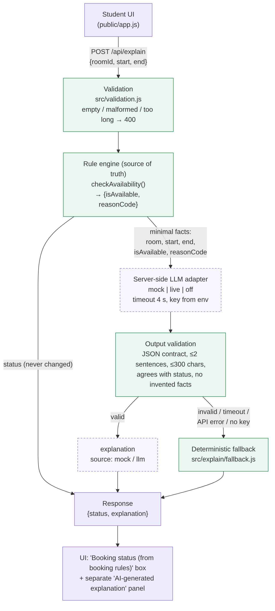

# Feature spec – "Explain availability"

## User story
As a student, I want a short explanation of room availability so I understand the decision.

## Inputs
| Where | Field | Rules |
|---|---|---|
| Student → API (`POST /api/explain`) | `roomId`, `start`, `end` | all required strings ≤ 32 chars, `YYYY-MM-DDTHH:MM`, known room, body ≤ 1 KB, no extra fields |
| Server → model (minimal facts) | `room` (label from server data), `start`, `end`, `isAvailable`, `reasonCode` | built by the server from the validated input and the deterministic result; no free user text |

## Outputs
- Model contract: `{"explanation": string}` – JSON only, ≤ 2 sentences, ≤ 300 chars, no HTML/links/markdown,
  agrees with `isAvailable` and mentions the `reasonCode`, no times/dates/rooms/names not in the facts.
- API response: `{ status: {room, start, end, isAvailable, reasonCode}, explanation: {text, source, generated, fallbackReason} }`
  where `status` always comes from `checkAvailability()` and `source` is `mock`, `llm` or `fallback`.

## Acceptance criteria
| ID | Criterion | How it is enforced |
|---|---|---|
| AC1 | Existing availability and overlap rules remain unchanged | `src/availability.js` untouched (`git diff checkpoint-baseline-green -- src/availability.js` is empty); baseline tests still pass |
| AC2 | Explanation agrees with the deterministic result; no invented booking details | `validateExplanation()` on every model output; failures → fallback |
| AC3 | Empty, malformed or overly long input is rejected | `validateRequest()` + body-size limit → HTTP 400 |
| AC4 | API timeout, error or unavailable key produces a safe fallback | `withTimeout()` (4 s), error mapping, `NO_API_KEY` short-circuit → `fallback.js` |
| AC5 | User can distinguish generated explanation from confirmed status | separate boxes: "Booking status (from booking rules)" vs "AI-generated explanation" + badge + disclaimer |

## Failure behaviour
| Failure | Behaviour | `fallbackReason` |
|---|---|---|
| Empty / malformed / too long input | HTTP 400, error message, model not called | – |
| No API key (live mode) | deterministic text, no network call | `NO_API_KEY` |
| Timeout (> 4 s) | request aborted, deterministic text | `TIMEOUT` |
| HTTP 401/403 | deterministic text | `AUTH_ERROR` |
| Network / 5xx | deterministic text | `API_ERROR` |
| Output not `{"explanation": string}` | deterministic text | `INVALID_OUTPUT` |
| Output contradicts status / invents facts / too long | deterministic text | `REJECTED_<reason>` |
| Feature switched off (`LLM_MODE=off`) | deterministic text | `DISABLED` |
| Browser request fails or > 8 s | UI shows "explanation unavailable, status above is still correct" | – |

In every case the booking status shown to the student is unchanged.

## Flow

The deterministic checker – not the LLM – decides availability. The model receives the decision as data and can only
describe it; its output is validated and may be thrown away, the status cannot.
